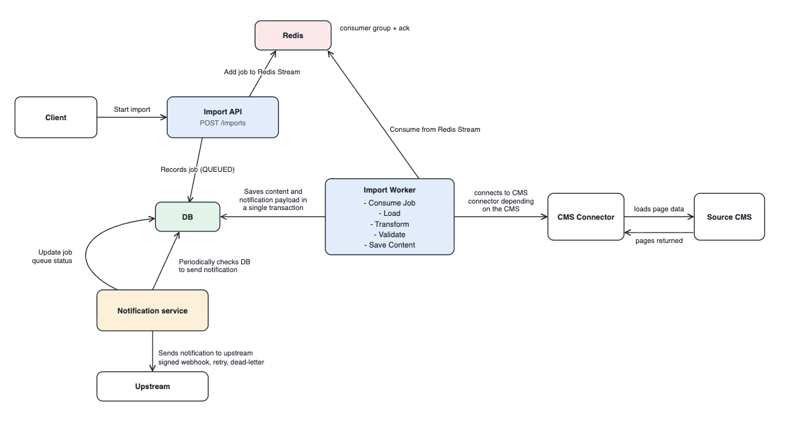
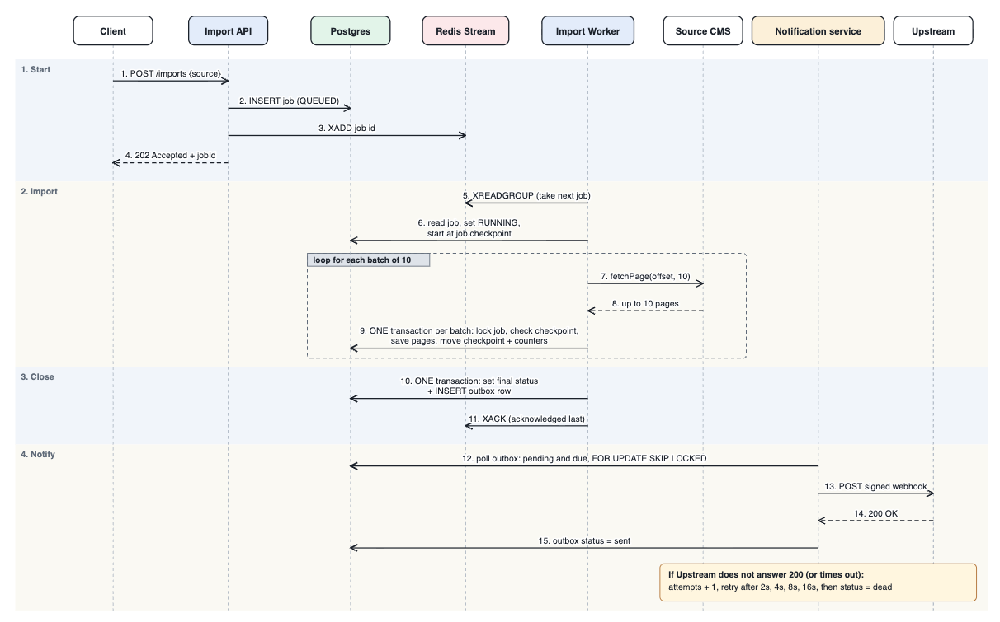
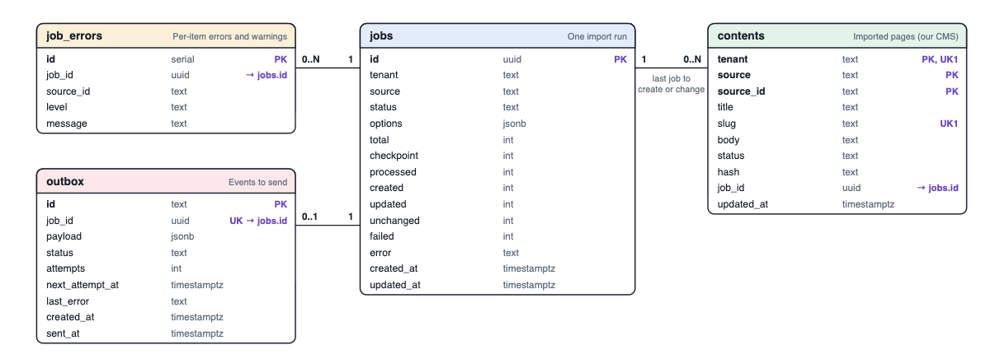

# Content Import and Upstream Notification: Design

How to run the prototype is in the [README](../README.md). This document covers what it does, how it is built, and why.

All source paths below are relative to `src/WcmsImport/`.

## 1. Problem

A customer of our Web Content Management System (WCMS) wants to move content from their current WCMS into ours. When the content has been imported, systems that depend on it (search, CDN, analytics) must be told it is available.

Two requirements follow:

1. **The import must survive real conditions.** Imports are large, source data is messy, and processes crash.
2. **The notification must be truthful.** We never announce content that is not saved, and we never lose the announcement of content that is.

## 2. Scope

**Covered by the prototype:** pages and articles (title, slug, HTML body, status) from two kinds of source, started through an HTTP API, saved to Postgres, and announced to one upstream system by signed webhook.

**Not covered** (see section 8): authentication and multiple tenants, images and files, custom fields, link rewriting, cancelling a job, a registry of several subscribers, metrics, and database migrations.

## 3. Assumptions

| # | Assumption | Impact if it changes |
|---|---|---|
| A1 | Import is self-service, started by the customer through an API or admin screen. | A one-off migration service would drop the API and keep the pipeline. |
| A2 | Only content items are imported. Binary assets, users, permissions and redirects come later. | Assets need their own pipeline (download, scan, de-duplicate, re-host). |
| A3 | Import only adds and updates. Content missing from the source is never deleted from ours. | Deletion needs a "mirror" mode with a safety limit. |
| A4 | Re-running an import is normal (for example a refresh before go-live), so it must be safe and cheap. | This drives the idempotent save and the content fingerprint. |
| A5 | Every source item has a stable unique id. | Without one, matching rules (slug, URL) would be needed to avoid duplicates. |
| A6 | A few known sources are supported, each with its own connector. | Arbitrary sources would need a customer-defined field mapping. |
| A7 | Sources fail and rate-limit, and their data is dirty (no title, duplicate slug, script tags, huge bodies). | Validation and retries could shrink. |
| A8 | A typical import is hundreds to about 100,000 items and takes minutes to hours. | Millions of items would need parallel workers within one job and streaming reads. |
| A9 | Upstream systems are internal or partner services that accept a signed webhook. | A message bus would replace the sender. The outbox stays. |
| A10 | At-least-once delivery is acceptable. Receivers ignore events whose id they have seen. | Exactly-once would need a transactional receiver. |
| A11 | One notification per job is enough. The receiver fetches details from a link. | Per-item events would flood receivers and would need batching. |
| A12 | A failed job that already saved content still notifies about what was saved. | The alternative, notifying only on success, is simpler but hides real content from upstream. |
| A13 | Order between different jobs does not matter, because receivers read current state from the link. | Ordering would need a sequence number per tenant. |
| A14 | A slug clash is fixed by renaming the page and recording a warning, not by rejecting it. | Rejecting instead is a one-line change in `Validation.UniqueSlug`. |
| A15 | One tenant and no authentication. | The tenant id would come from the caller's token and be part of every query. |

## 4. Architecture

*How the boxes map to containers:*
- **Import API** is `api`
- **Import Worker** is `importer` (`ImportService` is its loop that reads the stream and `ImportWorker` runs each job)
- **Notification service** is `notifier`
- **Source CMS** is `mock-cms`
- **Upstream** is `mock-upstream`. "Update job queue status" is the notifier setting the outbox row to `sent`, `pending` (retry) or `dead`

All five app containers run the same image. The first argument (`api`, `importer`, `notifier`, `mock-cms`, `mock-upstream`) selects the role in `Program.cs`.

| Component | File | Responsibility |
|---|---|---|
| Import API | `Api/ImportApi.cs` | Create the job row, enqueue it, answer `202`. Serve status, errors and content. |
| Redis Stream | `redis`, `Common/ImportQueue.cs` | Hand a job to exactly one worker. Keep it pending until acknowledged. |
| Import Worker | `Importer/ImportService.cs` | The loop: read the stream with a consumer group, claim abandoned jobs, acknowledge last. |
| | `Importer/ImportWorker.cs` | Run one job: read, convert, validate, save in batches, close the job. |
| Connectors | `Importer/Connectors.cs` | One mapper per source system, to our standard page shape. |
| Item rules | `Importer/Validation.cs` | Pure functions: validation, fingerprint, unique slug. |
| Job rules | `Importer/JobRules.cs` | Pure functions: final status, whether to notify, checkpoint decision, event shape. |
| Notification service | `Notifier/NotificationService.cs` | Poll the outbox, sign, send, retry, mark dead. |
| Webhook rules | `Notifier/Webhook.cs` | Pure functions: signature, verification, retry schedule. |
| Fault switches | `Importer/Faults.cs` | Demonstration only: trigger a rollback, a lost commit reply, a failing closing transaction or a crash on demand. |

The rules that make decisions (validation, status, retry plan, mapping) are pure functions in their own files. The files that touch the database or network only call them, so the rules can be tested without Docker.

### 4.1 Sequence of one import

*Read top to bottom. Dashed arrows are replies. Steps 9 and 10 are the two atomic writes the design relies on: the batch transaction (pages, checkpoint and counters) and the closing transaction (final status and outbox row). Step 11, the acknowledgement, comes last on purpose: if the worker dies before it, Redis hands the job to another worker. The diagram simplifies two things: it does not show the retries of a batch or a source read, nor the 3-attempt retry of the closing step (section 7).*

## 5. Key decisions

### 5.1 Background job, answered with 202
Imports take longer than an HTTP request should. `POST /imports` records the job and returns a job id straight away. Progress, counts and errors are read from `GET /imports/{id}`.

### 5.2 Postgres is the source of truth
Redis only says "someone should work on this". The Import API writes the job row first and then adds the id to the Redis Stream. If Redis lost a message, the job row would still say `QUEUED` and could be found. In the other order, a crash would leave a message for a job that does not exist.

### 5.3 Redis Stream with a consumer group, not Pub/Sub
Pub/Sub forgets a message if nobody is listening, and gives it to every listener if several are. A Stream with a consumer group gives each job to **one** worker and keeps it *pending* until acknowledged. The worker acknowledges **last**, after the job is closed in the database. If a worker dies mid-job, the message stays pending, and another worker claims it after a timeout (`XAUTOCLAIM`) and **resumes from the checkpoint**.

StackExchange.Redis shares one connection between all callers and does not support blocking reads (`XREADGROUP ... BLOCK`), so an idle worker polls the stream once a second.

### 5.4 One transaction per batch, with a checkpoint
Pages are saved in batches of 10. Each batch commits its pages, the job's checkpoint and its counters together. A failed batch rolls back completely, so there is never a half-saved batch, and a resumed job continues at the last checkpoint instead of at zero.

`jobs.checkpoint` is one integer: how many source items are already recorded. The batch transaction first locks the job row (`SELECT ... FOR UPDATE`) and compares the stored checkpoint with the position where the batch starts:

| Stored checkpoint | Meaning | Action |
|---|---|---|
| Equal to the batch start | Not recorded yet | Apply the batch |
| Ahead of the batch start | An earlier attempt already committed (the commit worked but the reply was lost) | Skip the batch. Counters are not added a second time. |
| Behind the batch start | The worker is ahead of the database | Stop with an error |

The lock also stops two workers from applying the same batch at the same time.

### 5.5 Idempotent save
A page is identified by `(tenant, source, source_id)`. The save looks it up: not found, create. Found with the same fingerprint, do nothing (`unchanged`). Found with a different fingerprint, update. The fingerprint is a SHA-256 hash of the stored fields (title, slug, body and status). Retrying a batch, resuming a crashed job and re-running a whole import are all safe, and a re-run only touches what changed.

### 5.6 Per-item failures do not stop the job
A page that fails validation is written to `job_errors` and skipped. A page the database refuses is undone with a **savepoint**, which rolls back that page only. Fixable problems (script tag, slug clash) are fixed and recorded as warnings. The job ends `COMPLETED_WITH_ERRORS` and the customer can see why each item failed.

### 5.7 Transactional outbox for the notification
The final transaction does two writes: it sets the job's final status and inserts a row in the `outbox` table. They commit together or not at all. A job is never marked complete without its notification waiting, and a notification never exists for an unfinished job. The Notification service polls the table, so a crash between "saved" and "sent" cannot lose the notification: the row is still there.

`UNIQUE (job_id)` on `outbox` means one event per job, even if the final step runs twice.

The closing step is kept apart from the work. Only a failure while reading or saving batches marks a job `FAILED`. A failure of the closing transaction is retried and never marks the job `FAILED`, because by then all content is saved and reporting `FAILED` would be wrong. Closing is also safe to repeat: if the job is already closed, it does nothing, so a retry cannot create a second outbox row.

### 5.8 Notification counts come from the job row
The event reports `created / updated / unchanged / failed` as stored on the job row, which covers the whole job. A job resumed after a crash therefore reports the batches saved before the crash. Counting only the resumed run would under-report.

### 5.9 Webhook delivery
- **Signed** with HMAC-SHA256 over the body, so the receiver knows the event is from us and unaltered.
- **Event id** in the body and in the `X-WCMS-Event-Id` header, so the receiver can ignore repeats. Delivery is at-least-once: a crash after the receiver answered but before the row is marked `sent` causes one repeat.
- **Retry** after 2s, 4s, 8s and 16s. After the fifth failed attempt the row becomes `dead`. A dead row stays in the table so it can be inspected.
- **Thin event:** counts plus a link (`/content?importJobId=...`). Receivers fetch what changed. The event stays small and stable, and no content is copied to every subscriber.
- **`FOR UPDATE SKIP LOCKED`** lets several notifier instances run without sending a row twice.

## 6. Data model

*The four tables and their relationships. `PK` is the primary key, `UK1` is a second unique key, and `→ jobs.id` is a link to the job. The prototype declares no foreign keys, so those links are by convention and the database does not enforce them. A production schema would add them, with indexes on `job_id`.*

| Table | Purpose | Key |
|---|---|---|
| `jobs` | One import run: status, checkpoint, counts, options | `id` |
| `contents` | The imported pages (our CMS) | `(tenant, source, source_id)`, plus unique `(tenant, slug)` |
| `job_errors` | Per-item errors and warnings | `id`, grouped by `job_id` |
| `outbox` | Events waiting to be sent, already sent, or dead | `id`, unique `job_id` |

Job status: `QUEUED` → `RUNNING` → `COMPLETED` / `COMPLETED_WITH_ERRORS` / `FAILED`.
Outbox status: `pending` → `sent` / `dead`.

A notification is created only when at least one page was created or updated. A job that changed nothing creates none.

## 7. Failure handling

| Failure | Result |
|---|---|
| A batch transaction fails (deadlock, timeout) | Rolled back whole. The worker waits and retries the same batch, up to 3 attempts. No duplicates, because saving is idempotent. |
| One page is rejected by the database | A savepoint undoes that page only. It goes to the error report and the rest of the batch is kept. |
| The source returns an error | The read is retried with a growing wait, up to 3 attempts. After that the job ends `FAILED` at its checkpoint and keeps what was saved. |
| The worker process dies | The Redis message was never acknowledged. After the claim timeout another worker claims it and resumes from the checkpoint. |
| The worker dies after closing the job but before acknowledging the message | Another worker claims the message after the timeout, sees the job is already closed, does nothing, and acknowledges it. No second outbox row and no second notification. |
| The commit succeeded but the worker never heard | The worker retries. The checkpoint is already ahead, so the batch is skipped: no duplicate pages and no double-counted totals. |
| The final transaction fails | It rolls back whole, so neither the job status nor the outbox row is written. The worker retries it, up to 3 attempts. A failure here never marks the job `FAILED`, because every batch is already saved. If all attempts fail, the job stays `RUNNING` and the Redis message stays unacknowledged. After the claim timeout another worker claims it, finds every batch done, and runs only the closing step. |
| The importer is stopped (deploy, `docker compose stop`) | A job in progress is not cancelled, because cancelling would report it `FAILED`. If the process is stopped before the job ends, it behaves like a crash: the message stays pending and another worker resumes from the checkpoint. |
| Upstream is down | The Notification service retries after 2s, 4s, 8s and 16s, then marks the event `dead`. The import is unaffected. |

## 8. Production gaps

Each item is also written as an `OMITTED` comment at the top of the file where it would be built.

| Area | Limitation | Where |
|---|---|---|
| Security | No authentication. The tenant is hard-coded. One shared webhook secret. HTML sanitising only strips `<script>` blocks. | `Api/ImportApi.cs`, `Common/Defaults.cs`, `Importer/Connectors.cs`, `Importer/Validation.cs` |
| Scale | No per-tenant limits or fair scheduling. One job has one checkpoint and so one worker. Pages are read in memory, not streamed. | `Importer/ImportWorker.cs` |
| Reliability | A crash between the job insert and the stream write leaves a `QUEUED` job nobody works on, and there is no sweeper to re-enqueue it. No cap on re-claims of a job that always crashes. No lease on the job row. No replay of `dead` events. One subscriber URL. The notifier holds a database lock during the HTTP call. | `Api/ImportApi.cs`, `Importer/ImportService.cs`, `Importer/ImportWorker.cs`, `Notifier/NotificationService.cs` |
| Checkpoint | The checkpoint is an offset into the source's list, so edits made to the source during an import can shift items. Paging by id or modified-since would avoid this. | `Importer/ImportWorker.cs` |
| Closing the job | The closing step is retried 3 times inside the worker. After that it relies on Redis re-delivery, with no alert and no cap on how often it is re-delivered. | `Importer/ImportWorker.cs` |
| Operations | No metrics, tracing, alerts or health endpoints. No migrations. No indexes beyond primary keys. No archiving of old rows. | `Common/Hosting.cs`, `sql/init.sql` |
| API | No idempotency key on `POST /imports`, no cancel, no pagination or rate limiting. The `/outbox` endpoint is for inspection only. | `Api/ImportApi.cs` |
| Product | Assets, custom fields, link rewriting, deletion mirroring, locales. | `Importer/Validation.cs`, `Importer/Connectors.cs` |

## 9. Testing

| Level | What it covers | How to run |
|---|---|---|
| Unit | Validation rules, fingerprint, slug uniqueness, source mapping (from JSON, as the source sends it), final status, notification rule, checkpoint decision, event shape, signature check, retry schedule | `dotnet test tests/WcmsImport.UnitTests` (no Docker needed) |
| End to end | First import, single delivery of the notification, silent re-run, update of only edited pages, batch rollback and retry, a batch retried after its commit succeeded, a failing closing transaction that is retried without marking the job failed, upstream outage and retry, rejected request | `dotnet test tests/WcmsImport.E2ETests` against the running stack |

Not automated: a worker crash and resume. It needs a restart policy and a wait for the Redis claim timeout, so it is run by hand with `./scripts/demo.sh crash`.
